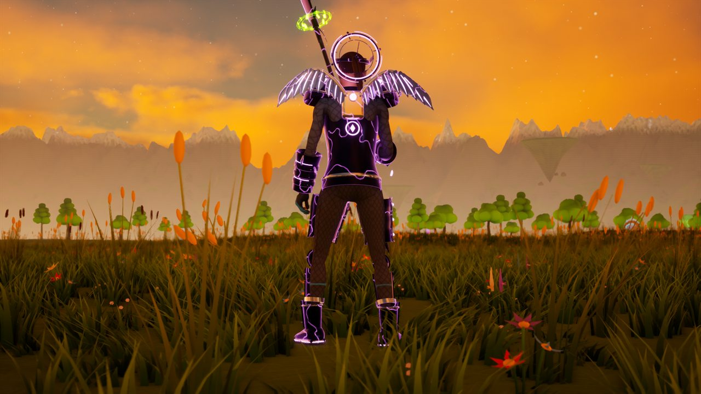
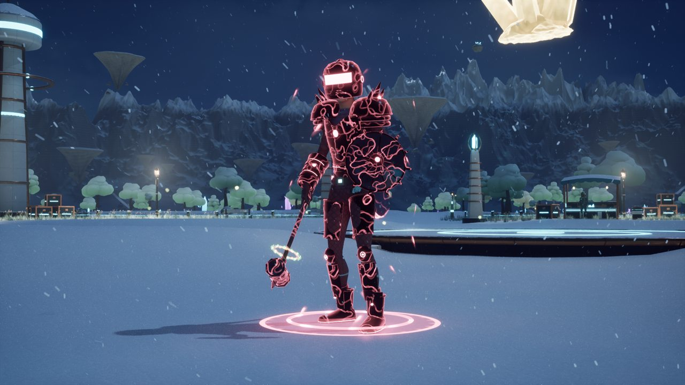
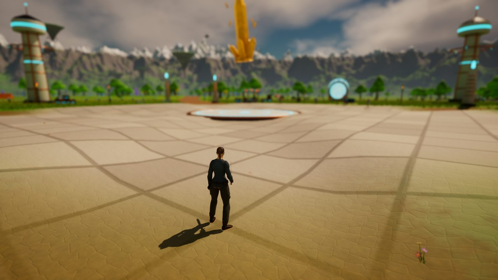

# Gelişim günlüğü

Yeniden eskiye. "Test aşamasında" yazan işler kodda bitmiştir; oyun içi doğrulaması sürüyor.

---

## 18 Kasım 2026

**Yeni ekran görüntüleri: kahramanlar en iyi ekipmanlarıyla**
- Üç sınıf da en güçlü setleri, mitik silahları ve efsanevi parçalarıyla oyun içinden yeniden fotoğraflandı (ana sayfada **Kahramanlar** bölümü).
- Oyun içi fotoğraf turu geliştirildi: kahraman kadrajda ortalanıyor, göğüs portresi ve sırttan çekim (kanat / pelerin) eklendi, çekim sırasında motor uyarıları kareye düşmüyor.

| Speeder | Panzer | Timex |
|:---:|:---:|:---:|
|  |  |  |

**Silah ve hareket cilası (2. tur)** · *test aşamasında*
- Timex'in asası zıplarken ve inerken artık yüzün önünden geçmiyor.
- Kalkan doğru yöne bakıyor; kola girmiyor, havada "tepsi" gibi yatmıyor.
- Panzer boştayken çekici öne uzatmak yerine bacağının yanında taşıyor.
- Zıplama ve inişteki ani silah sıçraması giderildi; geçişler tek ve yumuşak.
- Uzak karakterlerde de doğru tutuş; ön kol burulması ve havada boşta kalan kolun duruşu düzeltildi.

**Savaş kamerası (2. tur)** · *test aşamasında*
- Sevilen vuruş sarsıntısı korundu; boss ağır çekimindeki aşırı sallantı azaltıldı.
- Kamera ağaç, sütun, çit ve kemerlere girmiyor; en yakın boş noktaya yumuşakça kayıyor, engel kalkınca yavaşça geri açılıyor.
- Kahramanı örten düşmanlar yarı saydamlaşıyor; kamera dev bir bossun içine girerse boss tamamen soluyor.
- Yamaçlarda kamera yükseliyor, ışınlanmada yeniden ortalanıyor; dikey bakış ±80° ile sınırlandı.

**20 sınıf altyapısı başladı**
- Sınıfların tek bir kayıt sisteminden beslenmesi ve 17 yeni sınıfın iskeleti üzerinde çalışılıyor.

**Diğer**
- Yapımcılar ekranı güncellendi.
- Bu gelişim sayfası açıldı.

---

## 17 Kasım 2026

**Büyük tasarım belgesi tamamlandı**
- 17 yeni sınıf (toplam 20), her sınıf için uzmanlıklar, evrim ve uyanış sistemleri, denge kuralları.
- Dünya, hikâye ve görev planı: haritanın yaklaşık 4 katına çıkması, 6 yeni büyük bölge, 7 perdelik ana hikâye ("Yedi Kışın Borcu"), yaklaşık 285 yeni görev.

**Oyun içi odak efekti (alan derinliği)**
- Karakter keskin, arka plan yumuşak bulanık. Ayarlar'dan **Kapalı / Hafif / Sinematik** seçilebiliyor; savaşta otomatik hafifliyor.

| Kapalı | Sinematik |
|:---:|:---:|
|  |  |

**Savaş kamerası ve silah aralığı (1. tur)**
- Silahların gövdeye, kafaya ve pelerine girmesini önleyen sistem; kamera yakınlaştırma ve sarsıntı düzenlemeleri.
- Otomatik test sayısı 391'e çıktı (391/391 geçti).

---

## Kasım 2026 öncesi (özet)

- 3 sınıf (Speeder, Panzer, Timex), Gameplay Ability System ile yetenekler ve Rezonans sinerjisi.
- 6 × 6 km dünya, 5 bölge, 29 mob kampı, Kronit Kapıları, hover-kızak binek.
- Önsöz sineması, 25 görevlik ana hikâye, 26 yan görev, final boss Morvax.
- Dört mevsim, gün/gece, gerçek 3B kar ve yağmur, donan göl, Zaman Fırtınası dünya olayı.
- Envanter, ganimet, + basma, üretim, yetenek ağacı, başarımlar, günlük görevler, dünya haritası.
- Gerçekçi karakter oluşturma, berber, kumaş pelerinler, set zırhları.
- Sunucu otoriteli çok oyunculu yapı; otomatik duman testleri ve fotoğraf turu.
